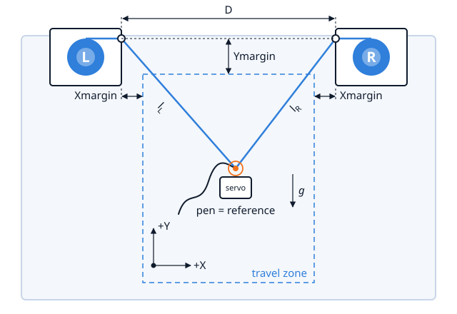

<p align="center"></p>

# corelr-plotter

Firmware for a **cable-driven wall plotter**: two stepper motors, **L** and **R**, each paying out one cable; a pen lifted by a servo;
an Arduino **Nano** (ATmega328P, 2 KB of RAM, 30 720 bytes of flash); a 2×16 I²C LCD and an analog joystick for the local user interface.
Jobs come from **either** an SD card **or** the serial link (a grbl 1.1 subset, driven by Candle 1.1.9) — one variant per firmware image,
chosen at build time.

It is a from-scratch design, not a port: `grbl` was the algorithmic reference (GCode, motion control, acceleration), `Walldraw` the hardware
reference ([which kit, and how its wiring differs](docs/hardware/Walldraw.md)). Every decision is recorded as a requirement of this project and the repository builds without either.

<p align="center"></p>

## Download
The compiled firmware of each version is on the [Releases page](https://github.com/ErnstTechnik/corelr-plotter/releases) (and in the *Releases* column of the project page). For each variant, `serial` and `sd`:
the image to flash (`.hex`), the linked `.elf` and the `.map`, the flat sketch for the Arduino IDE (`-ide.zip`), the API documentation (`-api.zip`), `build-info.txt` (commit, compiler, flags, sizes) and `SHA256SUMS`
(`sha256sum -c SHA256SUMS`). **No `.eep` file is shipped, on purpose**: it would overwrite the calibration stored in the EEPROM. Flashing resets the board; read the notes of the release first, they say whether a recalibration is needed.

## Status
Two variants, both built and measured on the Nano:

| Variant | Flash (of 30 720) | RAM (of 2 048) | Worst stack | On the machine |
|---|---|---|---|---|
| `serial` | 28 772 (1 948 free) | 936 | 405 | **verified** with Candle 1.1.9 and the serial probe: jog, `$H`, Safe position, Abort, pause/resume, position ring, plots |
| `sd` | 30 524 (196 free) | 1 477 | 328 | **run by the maintainer** (file browser, plots, arcs) with the current size flags |

Both need `-mcall-prologues` (the SD variant does not link without it); the size flags differ per variant (`cmake/size_flags.txt`). The position ring in EEPROM is verified on the machine.
The detailed, dated state of every check is in [`docs/bringup/Bringup-Status.md`](docs/bringup/Bringup-Status.md).

## Repository layout
```
firmware/      what is compiled for the AVR, and nothing else
  app/           the sketch: job state machine, glue
  src/           one .h + .c/.cpp per module (Stepper, Motion, GCodeParser, …)
  config/        HwConfig.h (pins, mechanics) and SwConfig.h (tunables, variant, arithmetic)
third_party/   vendored code under its own licence (sdfat; the Arduino AVR core), each with a PROVENANCE.md
requirements/  functional/ (REQ-CoreLR-F-*: what) and design/ (REQ-CoreLR-D-*: how), traced to each other
docs/          hardware (pin map, wiring), protocol (serial, EEPROM), bringup (journal, checklists), design-notes, doxygen (the Doxyfile template of the API documentation)
tests/         host/ (the real modules on the PC), mutation/ (mutants), bench/ (sketches and GCode for the machine)
tools/         analysis/ (size, stack, cycles), bench/ (serial probe, GCode check), generators/, prototypes/
```
Future work that is not decided yet (a four-line display, the Arduino UNO board, ...) is listed in [`docs/TODO.md`](docs/TODO.md). Start with [`requirements/README.md`](requirements/README.md) for the index, [`tools/README.md`](tools/README.md) for the instruments, and
[`CONTRIBUTING.md`](CONTRIBUTING.md) for how changes are made.

## Build and test
Needs `avr-gcc` 7.3.0, CMake ≥ 3.20 (the presets below need ≥ 3.25; with 3.20, configure by hand: `cmake -S . -B build/avr -G Ninja -DCMAKE_TOOLCHAIN_FILE=$PWD/cmake/avr-gcc.cmake`, and `-DCORELR_HOST_TESTS_ONLY=ON` for the host tests; the CI does it) and Ninja (host tests: `gcc`/`g++` with `-m32` and Python 3). Tell the build where the toolchain is once:
`cp local.conf.example local.conf` and edit it (or leave it empty if `avr-gcc` is on the PATH or in an Arduino IDE 1.8.x installation).
```
cmake --preset avr-default && cmake --build --preset avr-default     # both variants -> build/avr-default/corelr_{serial,sd}.hex (+ .map, firmware/*.elf)
cmake --preset host && ctest --preset host                           # host tests in both arithmetics, tool and link checks
cmake --build --preset host --target doc                             # API documentation (Doxygen), one per image -> build/doxygen/{serial,sd}/html/index.html; not part of the firmware build
tools/analysis/build_size.sh -v sd                                   # one variant: flash, RAM, free
tools/analysis/compare_with_ide.sh                                   # same image as the Arduino IDE's? (needs the IDE; proof, not routine)
```
The size limits of the Nano are enforced at link time. **Flashing** (`cmake --build --preset avr-default --target upload_serial`, or `upload_sd`) **resets the board**: a reset before the position is stored
(2 s of stillness) loses the calibration — only when the maintainer says so. Details and rationale: [`requirements/design/REQ-CoreLR-D-Build.md`](requirements/design/REQ-CoreLR-D-Build.md).
Arduino IDE (convenience, not the reference): `cmake --build build/avr-default --target export_ino` writes flat sketches under `build/avr-default/ide_sketch/` (generated, not committed; read its `README.txt`).
VS Code: open the folder, install the recommended extensions (`.vscode/extensions.json`), pick the `avr-default` preset; the tasks cover build, tests, size report and the (confirmed) flash.

## How this project is made
The design is the maintainer's; the code, the requirements, the tests and the documentation are written **with the assistance of Claude** (Anthropic's AI assistant),
and every commit made that way says so (`Co-Authored-By`). What makes the result trustworthy is not the tool but the method: each decision is a written requirement,
each tested behaviour is put through mutation testing, sizes and timings are measured, and what has run on the real machine is stated apart from what has only run on the PC
([`docs/bringup/Bringup-Status.md`](docs/bringup/Bringup-Status.md)). [`CLAUDE.md`](CLAUDE.md) is the working brief an assistant reads at the start of a session; it is also a short
summary of the rules for a human who wants to take the project over, with or without an assistant.

## Licence
GPLv3 ([`LICENSE`](LICENSE)). Third-party code keeps its own licence, listed in [`THIRD_PARTY.md`](THIRD_PARTY.md).
