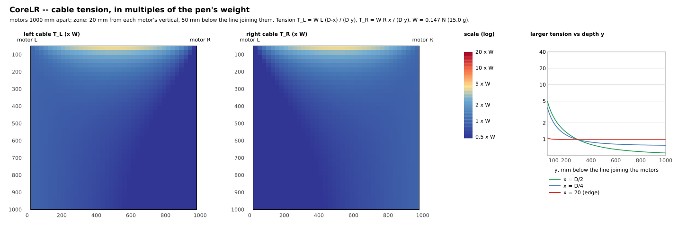

# Cable tension and the travel zone

The pen hangs from two cables that can only **pull**. Where the cables are nearly horizontal -- close to the line joining the two motors -- each has to pull
many times the weight of the pen, and on the outside of a motor's vertical nothing holds the pen at all. That is why the firmware never commands a position outside
the **travel zone** (`REQ-CoreLR-F-Motion-0008`, `REQ-CoreLR-D-Motion-0028`): `MOTION_MARGIN_SIDE_UM` (20 mm) inside the vertical of each motor and
`MOTION_MARGIN_TOP_UM` (50 mm) below the line joining the motors (`firmware/config/SwConfig.h`).

## The statics
Frame: origin at the left motor, `x` towards the right motor, `y` **down**; `D` the distance between the motors, `W` the weight of the pen assembly; the pen at `(x, y)`,
`L = hypot(x, y)` and `R = hypot(D - x, y)` the two cable lengths.

```
horizontal:  T_L * x / L        =  T_R * (D - x) / R
vertical:    T_L * y / L  +  T_R * y / R  =  W

        T_L = W * L * (D - x) / (D * y)          T_R = W * R * x / (D * y)
```
At mid-span (`x = D/2`) both are `W * L / (2 y) = W / (2 sin(angle below the horizontal))`. The tensions depend on the *shape* of the geometry only (scale it, nothing changes)
and are proportional to `W`, so the charts give them in **multiples of the pen's weight** ("x W"). Not modelled: the cables' own weight, friction where they leave the motors,
the motors' holding torque -- this is the static load the pen puts on the cables. At `y -> 0` the tension is unbounded; for `x < 0` or `x > D` one cable would have to push (negative).

## The tool
`tools/generators/gen_tension_chart.py` (`-h` for all the options; tested by `tests/tools/test_tension_chart.py`, itself put through `tools/mutate.py`):

```
tools/generators/gen_tension_chart.py -D 1000                                  # the tables, below, for a 1 m span
tools/generators/gen_tension_chart.py -D 1200 --top 80 --mass-g 15 --height 800 --svg /tmp/t.svg
tools/generators/gen_tension_chart.py -D 1000 --csv /tmp/grid.csv --quiet      # the grid, for any other tool
```
Give it YOUR geometry (`-D` is the distance between the cable exit points, the "motor distance" of the calibration) and a mass in grams to read newtons.

## For the default geometry: 1 000 mm between the motors, the firmware's margins
The output of `gen_tension_chart.py -D 1000 --mass-g 15`:

```
Cable tension, in multiples of the pen's weight (x W); W = 0.147 N for a 15.0 g pen assembly
Geometry: motors 1000 mm apart; travel zone: 20 mm from each motor's vertical, 50 mm below the line joining them, down to 1000 mm

At the top edge, mid-span: 5.02 x W per cable (the two are equal)
Worst on the top edge: 5.02 x W, cable L, at x = 495 mm from the left motor
Worst in the whole zone: 5.02 x W at x = 500 mm, y = 50 mm

Abaque 1 -- the larger of the two tensions (x W) as the pen goes down, for a few positions across the span
      y (mm)   x = 20 (edge)         x = D/8         x = D/4         x = D/2
          50            1.06            2.36            3.82            5.02
          60            1.03            2.02            3.21            4.20
          80            1.01            1.62            2.46            3.16
         100            1.00            1.40            2.02            2.55
         150            0.99            1.14            1.46            1.74
         200            0.98            1.03            1.20            1.35
         300            0.98            0.95            0.98            0.97
         400            0.98            0.92            0.88            0.80
         600            0.98            0.89            0.81            0.65
         800            0.98            0.89            0.79            0.59
        1000            0.98            0.88            0.77            0.56

Abaque 2 -- the top margin: the worst tension (x W) on the line `margin` below the motors, between the side margins
  margin (mm)    worst x W      cable      at x (mm)
          10        25.00          L            500
          20        12.51          L            500
          30         8.35          L            500
          40         6.27          L            500
          50         5.02          L            495   <- the firmware's margin
          60         4.20          L            495
          80         3.17          L            495
         100         2.55          L            490
         150         1.74          L            476
         200         1.35          L            457

In newtons (15.0 g): top edge mid-span 0.74 N per cable; worst on the top edge 0.74 N
```

Reading it: with the **top margin at 50 mm** the cables carry at most about **5 times the weight** of the pen (0.74 N for a 15 g assembly); at 20 mm it would be **12.5 times**, at 10 mm **25 times**;
deeper than about 300 mm it is close to 1 x W everywhere. A shorter span makes the same margin worse (the cables are flatter), a longer one better: run the tool with your own `-D` before changing a margin.



*Regenerate with* `tools/generators/gen_tension_chart.py -D 1000 --svg-step 25 --mass-g 15 --svg docs/hardware/images/Tension.svg --quiet`
*(`tests/host/run_all.sh` checks that the committed picture is what the tool writes).*
