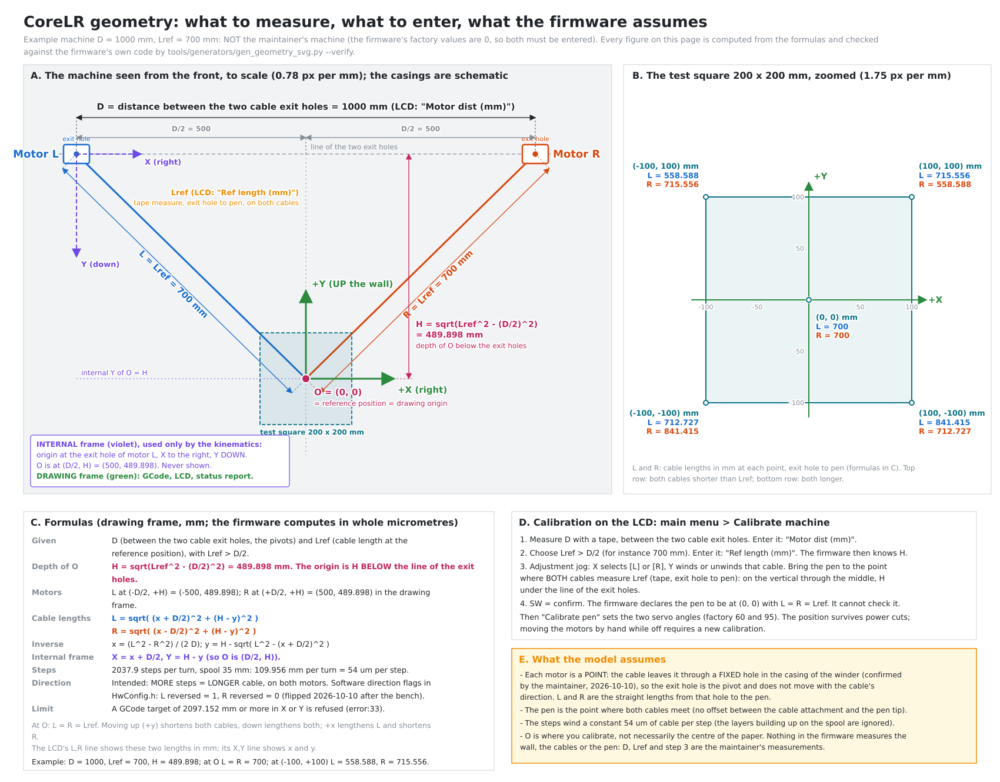

# Functional Requirements — Calibration

Sub-function: **Calibration** — establish, and persist across power
cycles, the geometric parameters and reference position needed to
convert between cable lengths (L, R) and Cartesian coordinates (X, Y).

Origin: see workspace `Traceability.md` (not part of this repository).
Status: Approved (2026-09-06)
See also: [`../Design/REQ-CoreLR-D-Calibration.md`](../design/REQ-CoreLR-D-Calibration.md),
[`../Design/REQ-CoreLR-D-Motion.md`](../design/REQ-CoreLR-D-Motion.md)
(the only place that applies the drawing-origin offset, `-0006`);
related: [`REQ-CoreLR-F-UserInterface.md`](REQ-CoreLR-F-UserInterface.md)
(jogging UI), [`REQ-CoreLR-F-PenControl.md`](REQ-CoreLR-F-PenControl.md)
(pen setpoints, calibrated the same way)

## REQ-CoreLR-F-Calibration-0001 — Fixed mechanical parameters

The following parameters are fixed (not user-configurable): motor steps
per revolution, pulley/spool diameter, rotation direction (per motor).

**Realized as** compile-time constants in `HwConfig.h` (see
`docs/standards/STD-FileOrganization.md`, "Centralized configuration headers") — no
dedicated Design requirement beyond that, since there is no algorithm or
data structure choice involved, only fixed values.

**Rotation direction, per motor** (`STEPPER_MOTOR_L_REVERSED`, `STEPPER_MOTOR_R_REVERSED`): the intent is that **more steps lengthens the cable** on both motors.
Which flag achieves it depends on the wiring of the coils and on the winder, and only the bench can say. **2026-10-10: the bench showed both motors turning the
wrong way** (maintainer), which explained the machine's behaviour; both flags were flipped (L 0 → 1, R 1 → 0). They are compile-time, not user-configurable,
by this requirement; a menu or EEPROM setting would be a new requirement.

## REQ-CoreLR-F-Calibration-0002 — Configurable installation parameters

The following parameters shall be user-configurable, have a factory
default, and persist across power cycles: distance between the two
motors, reference position, reference cable length.

## REQ-CoreLR-F-Calibration-0006 — Drawing origin offset (confirmed 2026-09-07)

The machine's internal kinematics reference frame (used only for the
X,Y↔L,R math, anchored at motor L's pivot) is **not** mechanically
reachable at its own origin (`L=0` is impossible) and is never shown to
the user. The system shall therefore maintain a separate, configurable
**drawing origin offset** — the internal-frame position that GCode's
`(0,0)` (and everything the user sees: the status screen, jog display)
maps to. By default this offset equals the calibration reference
position (`REQ-CoreLR-F-Calibration-0004`) — so calibrating the machine
also defines where the drawing origin sits — but it is stored as its
own parameter, independently adjustable later, not re-derived from the
reference position every time.

**Rationale:** without this, GCode/display coordinates would be
expressed relative to an unreachable, physically meaningless point.
Separating "internal kinematics frame" from "user/GCode-facing frame"
also means only one function (`Motion_XYToLR`) ever needs to
know the offset exists — everything else in the system (GCode parsing,
status display, calibration workflow) works purely in the user-facing
frame.

## REQ-CoreLR-F-Calibration-0003 — Position persistence (revised 2026-10-06)

The machine's current position shall persist across power cycles, so
that it does not need recalibration at every startup. After a power
cycle the machine is considered calibrated **if and only if** the
persisted position is known to be valid (`REQ-CoreLR-F-Calibration-0007`).

The persisted quantity is the **absolute step count of each motor**
(L, R), which is what the motors physically hold. The Cartesian
position is, in principle, *derived* from it (maintainer,
2026-10-06); for now it is stored beside it, to save the flash the
derivation costs (`REQ-CoreLR-D-Calibration-0007`, open items). It follows that the user is responsible for one case the
machine cannot detect: **if the motors were moved while unpowered
(by hand), the user must recalibrate.**

*(The earlier alternative — returning to the reference position when
idle or at shutdown — is not planned.)*

## REQ-CoreLR-F-Calibration-0004 — Reproducible reference position

The system shall support establishing a reproducible calibration
reference position without depending on an external physical mark on
the wall.

## REQ-CoreLR-F-Calibration-0005 — Manual positioning for calibration

The user shall be able to manually move each motor (L, R) independently,
to physically bring the pen/cursor to the reference position for
(re-)calibration (see `REQ-CoreLR-F-UserInterface-0005`, "Adjustment"
jog mode).

## REQ-CoreLR-F-Calibration-0007 — Position validity across sudden power loss (confirmed 2026-10-06)

The system shall never restore a position that may be stale.

- From the moment a motor **may** move until the new position has been
  stored, the persisted position is marked **invalid**.
- The persisted position is marked **valid** only once the machine is
  stationary and its absolute step counts have been written.
- At startup, an invalid (or absent, or corrupted) persisted position
  means *not calibrated*: the installation parameters are kept (distance,
  reference cable length, drawing-origin offset, pen angles), but the
  user must re-establish the position through the "Calibrate machine"
  workflow.

**Consequence worth stating:** a power cut **during** a jog or a job
costs a recalibration, by design. That is the cheap, safe failure — the
alternative is restoring a position that is wrong by up to the whole
travel since the last store, and drawing offset from where the user
believes it to be, with no indication.

**When the position is stored** (maintainer, 2026-10-06):

| Situation | Store |
|---|---|
| manual control | after **2 seconds** without motion |
| file mode | at the end of the file, once the motion has drained |

Realized by `REQ-CoreLR-D-Calibration-0006`…`-0008`.

## REQ-CoreLR-F-Calibration-0008 — The geometry the system works in, and what the user measures (2026-10-10)

The machine's geometry shall be as drawn in [`../../docs/hardware/images/Geometry.svg`](../../docs/hardware/images/Geometry.svg), which is part of this specification:

- **Two dimensions are measured and entered by the user**: `D`, the distance between the two motors' pivots, and `Lref`, the cable length from a pivot to the pen at the reference position, the same for both
  cables, with `Lref > D/2`. Nothing else about the installation is entered; the firmware's factory values for both are 0.
- The **reference position** is the point where both cables measure `Lref`: on the vertical through the middle of the two motors, at the depth `H = sqrt(Lref² − (D/2)²)` below the line of the pivots.
  It is where the user brings the pen with the Adjustment jog and confirms (`-0004`, `-0005`), and it **is the drawing origin** (`-0006`): GCode `(0, 0)`.
- **Drawing frame** (GCode, LCD, status report): origin at the reference position, `+X` to the right, `+Y` **up** the wall (`REQ-CoreLR-F-GCodeInterpreter-0014`). In it the motors are at
  `(−D/2, +H)` and `(+D/2, +H)`, and the cable lengths of a point `(x, y)` are `L = √((x + D/2)² + (H − y)²)`, `R = √((x − D/2)² + (H − y)²)`.
  **Internal frame** (kinematics only, never shown): origin at the pivot of motor L, `+X` to the right, `+Y` down; the reference position is `(D/2, H)`.
- The model treats each motor as a **point**: the cable leaves it through a **fixed hole in the casing of the winder** (confirmed by the maintainer, 2026-10-10), so the exit hole is the pivot and does
  not move with the cable's direction; `D` is measured between the two holes and `L`, `R` from a hole to the pen. The pen is the point where the cables meet, and the steps wind a constant 53.96 µm of cable (35 mm spool, 2037.886 steps a turn: the 28BYJ-48's real gear ratio, `HwConfig.h`; 53.7 µm before 2026-10-26)
  per step (the layers building up on the spool are ignored).
- **More steps = longer cable**, on both motors (`REQ-CoreLR-F-Calibration-0001`: the direction flags in `HwConfig.h`; the Adjustment jog and every move rely on it).

**Why this is written down:** a misreading of any of these — where a length is measured from, where the origin is, which way Y points — gives a drawing that is the right shape in the wrong place or the wrong size,
with no error shown. The picture is generated (`tools/generators/gen_geometry_svg.py`) and **checked against the firmware's own `Calibration.c` and `Motion.c`**: every length on it agrees with them to 2.5 µm (the firmware floors to
the micrometre); `tests/host/run_all.sh` fails if the picture, its generator and the firmware ever disagree.

## REQ-CoreLR-F-Calibration-0009 — The geometry must leave a usable zone (specified 2026-10-11)

A calibration whose motor distance and reference cable length put the **reference position** (where calibration ends and the drawing origin defaults to, `-0004`) outside the travel zone (`REQ-CoreLR-F-Motion-0008`) is **refused**: nothing is stored and the machine keeps its previous geometry. That
also refuses a distance too small for a zone to exist between the margins. A change of the pen angles or of the drawing origin, which leaves the geometry as it is, is not subject to this.

## REQ-CoreLR-F-Calibration-0010 — The user sets the drawing origin (specified 2026-10-11)

Origin of the requirement: the maintainer, 2026-10-11 -- GCode generators do not agree on where (0, 0) is (the corner of the image, its centre, ...), so the drawing origin of `-0006` has to be placeable by the user wherever the generator puts it. Three ways, one stored origin:
1. **From the LCD menu**, with the pen where the generator's (0, 0) is on the paper: **"Set origin"** declares the pen's current position to be (0, 0); **"Origin = calib."** puts the origin back at the calibration reference point (`-0004`). Each asks for a confirmation.
2. **From GCode**, as grbl does it: `G92 X.. Y..` and `G10 L20 P1 X.. Y..` declare the current position to be (X, Y) (`REQ-CoreLR-F-GCodeInterpreter-0017`).
3. **By calibrating**: "Calibrate machine" puts the origin at the reference point, as it always did.
The origin is **stored** (it survives a power cut) **whichever way it was set -- including `G92`, which grbl keeps in RAM only** (maintainer's decision): one origin, not two. It is only set while the position is known (the machine is calibrated) and **nothing is moving**. **The origin is always inside the travel zone** (`REQ-CoreLR-F-Motion-0008`): a request that would put it outside is refused and the previous origin kept
(the pen's own position is inside the zone, so "Set origin" always passes; a `G92` with other coordinates can put the origin elsewhere, and is refused when that is outside). Changing the origin moves nothing and shifts every coordinate the user sees (status screen, jog, `MPos`), and the travel zone with them -- the zone itself stays where the cables allow.

## Open items
- *(Closed 2026-10-10: the cable leaves each motor through a fixed hole, so the point model holds and the spool's radius plays no part; the earlier worry of a ~7 mm error from a tangential exit does not apply.)*
- **The layers of cable building up on the spool** change the length wound per step slightly; ignored (a constant 53.96 µm per step). Measure it by drawing the square and measuring it.
- The Design items are tracked in the linked Design file.
